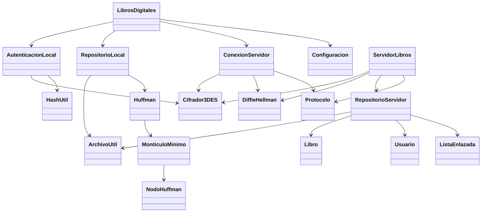
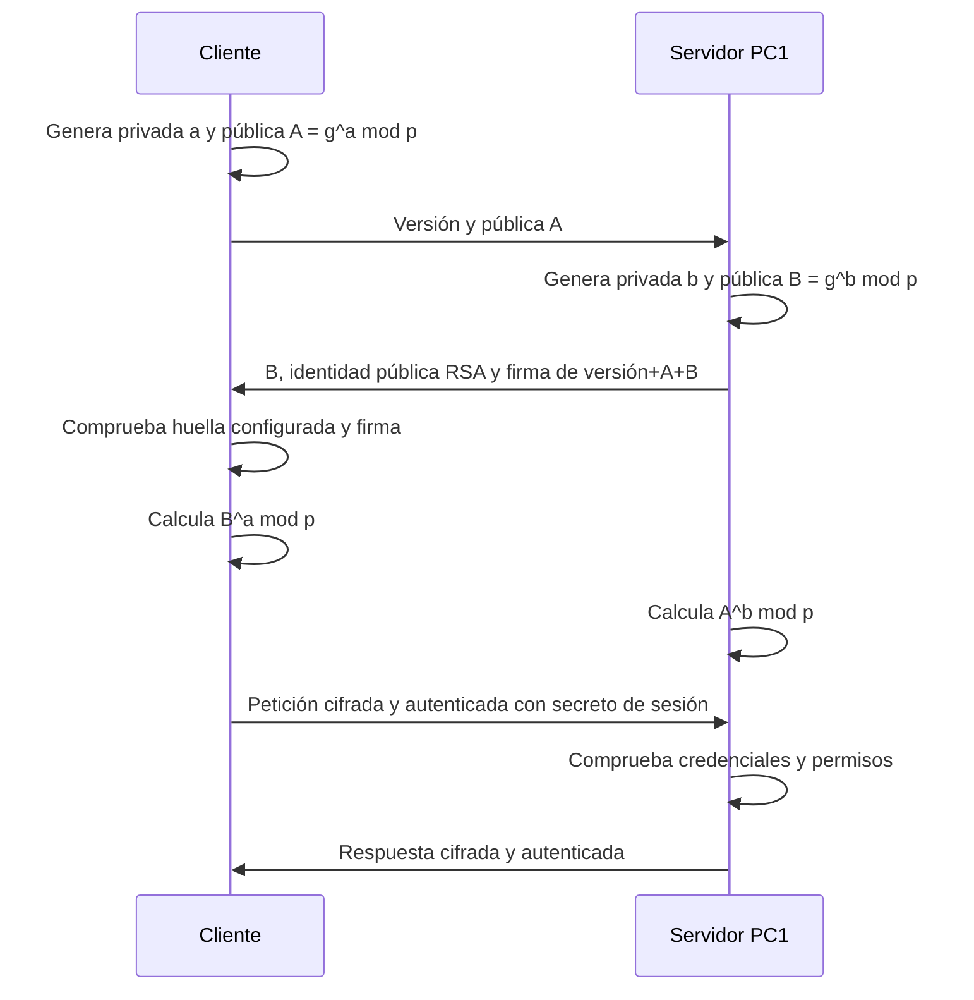
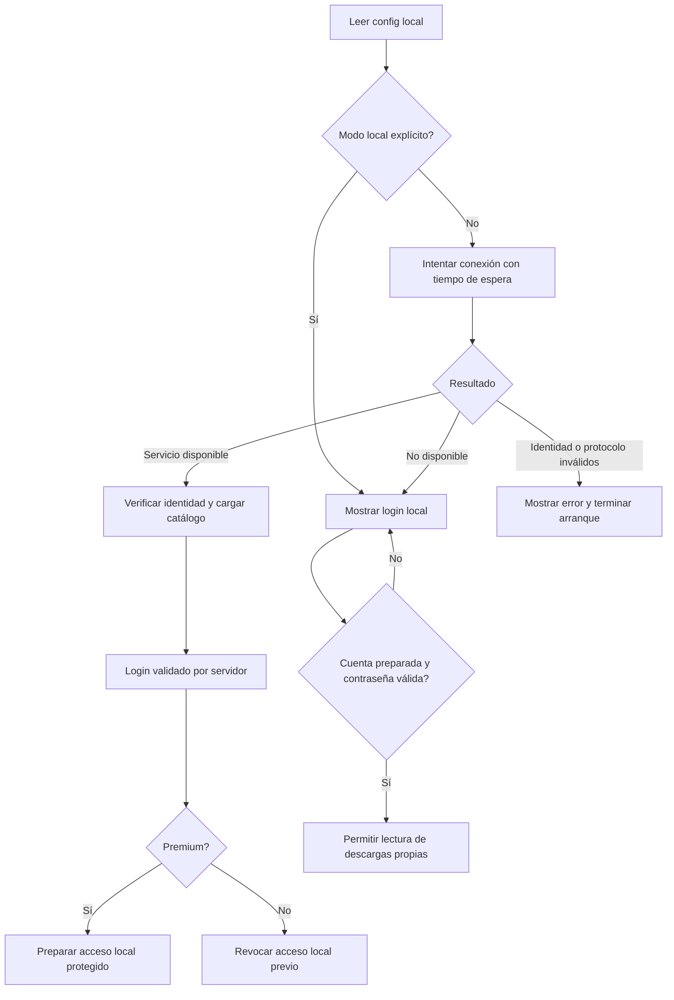

# Manual técnico

## Arquitectura

V2 utiliza dos procesos principales: `ServidorLibros` y `LibrosDigitales`. La carpeta de datos permanece en el equipo servidor y puede compartirse por SMB. El servicio TCP consulta esos archivos y entrega sus datos a los clientes. Cada operación utiliza una conexión y un secreto de sesión nuevos.



## Flujo de conexión y claves



`p` y `g` son valores públicos predeterminados del grupo 14 de RFC 3526. Cada proceso genera una privada aleatoria de 320 bits; las privadas no viajan ni se muestran. Se valida el rango y la pertenencia al subgrupo de las públicas recibidas. Las potencias modulares se implementan con `BigInteger.modPow`.

La firma RSA autentica la negociación; no sustituye Diffie-Hellman. La huella SHA-256 de la identidad pública se configura en el cliente por un canal conocido, copiándola desde la instalación de PC1. Una huella o firma incorrecta impide el acceso en línea y no provoca una aceptación silenciosa del servidor.

## Dos tipos de cifrado

1. **Almacenamiento:** una clave aleatoria de 32 bytes, conservada únicamente en el archivo privado del servidor, permite abrir los libros guardados en `servidor_v2/libros`.
2. **Sesión:** el secreto DH de la conexión genera otra pareja de claves para la entrega por red.

El servidor conserva el archivo original cifrado, recupera temporalmente su texto en memoria y genera una entrega cifrada con el secreto de esa conexión. Envía ambos cifrados dentro de una respuesta protegida. El cliente guarda el original idéntico y la entrega antes de descifrar el libro. La lectura termina en consola; la descarga aplica Huffman al texto.

El formato `TDES2` contiene versión, IV aleatorio de 8 bytes, cifrado 3DES/CBC/PKCS5Padding y HMAC-SHA256. Las claves de cifrado de 24 bytes y de HMAC se derivan con etiquetas distintas. HMAC cubre la versión, el IV y el cifrado; se verifica antes del descifrado.

3DES se conserva por ser una exigencia académica del enunciado. El proyecto es un prototipo para evaluación, con las limitaciones descritas más abajo.

## Autenticación

El archivo del servidor conserva `usuario|SHA-256(contraseña)|premium`. Los registros se validan y el servidor vuelve a leerlos para cada autenticación o solicitud de libro. El hash de acceso se envía dentro del canal autenticado y cifrado; no se envía antes de comprobar la identidad del servidor.

El acceso local se prepara únicamente después de una autenticación Premium en línea correcta. PBKDF2WithHmacSHA256, con sal aleatoria de 16 bytes y 210000 iteraciones, deriva el material para proteger la cuenta local. El contenido autenticado incluye nombre, categoría y catálogo. No se almacena el hash SHA-256 de acceso ni la contraseña en ese archivo.

La categoría local representa la última verificación en línea. Una autenticación posterior como estándar elimina el acceso local de esa cuenta. Sin comunicación no es posible conocer cambios hechos en el servidor después de la última validación. Los cambios de contraseña requieren volver a preparar el acceso local con conexión. Un administrador con control completo del equipo o del código queda fuera del modelo de protección del prototipo.

## Arranque y lectura local



La recuperación automática local se aplica a falta de conectividad y tiempo de espera. Una contraseña incorrecta en línea no se convierte en un acceso local exitoso. El argumento `--sin-conexion` permite omitir la red cuando el usuario quiere leer únicamente sus descargas.

## Huffman y archivos dañados

Se cuentan unidades `char` de Java: un emoji puede ocupar dos unidades UTF-16, que se recuperan en el mismo orden. Se insertan hojas en orden ascendente de carácter y se construye el árbol con el montículo propio. Cliente y descompresor utilizan el mismo procedimiento determinista.

`HUFFMAN2` consta de seis líneas:

```text
HUFFMAN2
cantidad_de_caracteres
cantidad_de_bits_utiles
codigo:frecuencia;codigo:frecuencia;...
bytes_empaquetados_en_Base64
SHA256_del_texto_UTF8
```

Se verifican número de líneas, versión, números, rangos, tabla ordenada sin duplicados, suma de frecuencias, bits calculados, cantidad exacta de bytes, Base64 canónico, relleno final cero, recorrido completo del árbol, longitud recuperada, frecuencias recuperadas y resumen SHA-256. Los casos vacío y de un único carácter tienen comprobaciones específicas. El hash detecta daño accidental; alguien capaz de sustituir el contenido y recalcularlo puede crear otro archivo Huffman válido.

Una compresión no garantiza un archivo menor: la tabla, el resumen y Base64 generan sobrecarga. La consola compara bytes UTF-8 originales con bytes del archivo completo.

## Archivos, concurrencia y límites

- Lecturas UTF-8 estrictas: se rechazan secuencias inválidas. Se permite BOM al inicio de un archivo de texto.
- Máximo de archivo/mensaje: 32 MiB; máximo de texto Huffman: 2000000 unidades `char`.
- Máximo de usuarios y de libros en los archivos de entrada: 10000 de cada uno.
- Ocho trabajadores de servidor, con cola de hasta 16 conexiones pendientes. Cada conexión tiene tiempo de espera.
- Las solicitudes utilizan enteros de longitud y límites antes de reservar memoria; los mensajes pequeños de negociación y petición tienen límites menores.
- Las escrituras locales usan un temporal y reemplazo atómico cuando el sistema lo admite. Un archivo `.lock` coordina procesos que escriben el mismo destino; existe una espera breve y acotada para conflictos de reemplazo en Windows.
- ISBN no permite separadores de ruta. Se comprueba la ruta real del libro para impedir salir de la carpeta mediante enlaces.
- El servidor lee durante el uso normal; el generador crea otro almacén y no lo sobrescribe. No edites en paralelo los datos fuente mientras haces la demostración; si necesitas cambiarlos, prepara archivos completos y reemplázalos con el servicio detenido.

Las listas de usuarios, libros y descargas utilizan `ListaEnlazada`. Huffman utiliza `MonticuloMinimo` y `NodoHuffman`, conservando las estructuras implementadas individualmente. Las utilidades estándar se usan para archivos, criptografía, sockets y ejecución concurrente.

## Migración y compatibilidad

El importador V1 recupera libros con los valores históricos del proyecto original y crea otro almacén con clave e identidad nuevas. Esos valores históricos no se emplean como privadas de las conexiones V2. El origen no se modifica. Un origen V2 no puede importarse como V1: se conserva su archivo privado para utilizarlo.

Las descargas V1 no contienen el SHA-256 del formato nuevo y se deben descargar otra vez. No se presentan como archivos cuya integridad ya esté validada.

## Fuentes de referencia

- RFC 3526, sección 3, parámetros públicos del grupo MODP de 2048 bits: https://www.rfc-editor.org/rfc/rfc3526.html#section-3
- Java, acuerdo de claves y concepto de secreto compartido: https://docs.oracle.com/en/java/javase/25/docs/api/java.base/javax/crypto/KeyAgreement.html

La implementación didáctica de las potencias DH está en `DiffieHellman.java`; no utiliza `KeyAgreement` para reemplazar ese cálculo.
